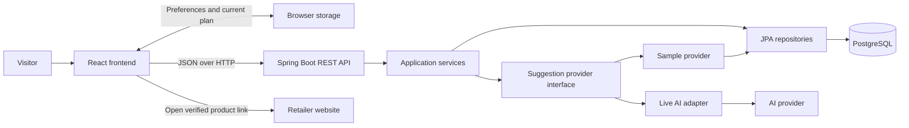

# Meal Planner Architecture

## Purpose and Status

This document describes the target architecture for the [requirements](REQUIREMENTS.md). The [development plan](DEVELOPMENT_PLAN.md) records which increments are implemented and verified. Follow it one task at a time.

The first version serves anonymous visitors in Ireland. It suggests one meal at a time, supports American, Irish, and Vietnamese cuisine, and connects recipe ingredients to curated retailer products. Build the sample experience first, then introduce live AI through the same business flow.

## System Overview

Use one repository, one React frontend, one Spring Boot application, and one PostgreSQL database. A single backend keeps deployment and debugging manageable while exposing clear boundaries to learn.



The browser never connects to PostgreSQL or the AI provider directly. Opening a retailer page is a visitor action; the app does not create baskets or purchase items.

## Technology and Responsibilities

| Component | Technology | Responsibility |
| --- | --- | --- |
| Interface | React, TypeScript, Vite | Preferences, suggestions, recipe details, and grocery list |
| Styling and navigation | Tailwind CSS, React Router | Responsive layout and page transitions |
| Server response state | TanStack Query | Loading, errors, and API response caching |
| Interactive state | React state | Selected recipe, servings, and checklist changes |
| Business API | Java 21, Spring Boot, Gradle | Validation and coordination of application services |
| Persistence | Spring Data JPA, PostgreSQL | Curated ingredients, samples, products, and mappings |
| Database changes | Flyway | Versioned schema and seed-data migrations |
| Live suggestions | Spring RestClient, OpenAI Responses API | Backend-only structured recipe generation |
| Local environment | Docker Compose | Database initially; full-stack containers in the final phase |

Select and record compatible dependency versions during setup. Keep live AI disabled by default. No global frontend state library, message queue, or separate AI microservice is needed initially.

## Code Organization and Boundaries

The planned top-level structure is:

```text
frontend/     React application and frontend/browser tests
backend/      Spring Boot application, migrations, and backend tests
docs/         Later API examples and decision records, when needed
```

Keep the three planning documents at the repository root. Create application directories only during their setup tasks.

### Frontend

Organize by features: preferences, meals, and groceries. Share API access, reusable controls, and browser-storage helpers only when there is an actual shared use.

- Use TanStack Query for backend requests; avoid a second copy of server response state without a clear purpose.
- Use local React state for editing, serving adjustments, and checklist interaction.
- Persist the current visitor plan through a small browser-storage boundary with validation and a storage-version identifier.
- Treat the backend as authoritative for accepted preferences, recipes, and product matches. Client validation supports usability.

### Backend

Organize packages by feature: catalog, meals, and groceries, with an AI integration boundary. Within a feature:

| Layer | Responsibility |
| --- | --- |
| Controller and DTOs | Accept requests, validate fields, and return explicit API responses |
| Service | Apply business rules and coordinate providers or repositories |
| Repository | Read curated data using JPA |
| Entity | Represent persisted data; remain internal to the backend |
| Calculation helper | Perform independently testable quantity conversions and pack calculations |

Controllers should not contain recipe filtering or product-matching logic. Services should not depend on browser behavior. Keep sample and live suggestion providers behind one application-facing interface so the UI does not need separate recipe formats.

## Data Ownership and Relationships

| Data | Owner | Lifetime |
| --- | --- | --- |
| Ingredients, forms, and aliases | PostgreSQL | Curated catalog |
| Retailers, products, verification dates, and mappings | PostgreSQL | Curated catalog |
| Sample recipes and their ingredient requirements | PostgreSQL | Curated fallback/demo data |
| Preferences, chosen recipe, servings, product choices, and checklist progress | Browser storage | Until cleared by the visitor or browser |
| Live generation inputs and responses | Backend memory during processing | Request processing only |
| Provider credentials and model configuration | Backend environment | Runtime configuration |

An ingredient has a stable identity that includes its relevant form. Canned chickpeas and dried chickpeas must be distinct identities. A retailer has many products. Reviewed mappings connect an ingredient to suitable products. A sample recipe contains ingredient quantities and cooking steps, and is tagged with cuisine, meal type, diet, servings, and time.

Define exact tables and DTO fields in the relevant task plan. Use database constraints for relational integrity and catalog checks for referenced ingredient identities. Do not create visitor accounts, saved server-side plans, or permanent histories of live recipes.

## API Boundaries

| Endpoint | Input | Output and responsibility |
| --- | --- | --- |
| `GET /api/v1/options` | No visitor preferences | Supported cuisines, meal types, diets, time choices, ingredients, retailers, and generation mode |
| `POST /api/v1/meal-suggestions` | Preferences, servings, exclusions, and requested sample/live behavior | Compatible recipes, the actual generation mode, and an explanatory message |
| `POST /api/v1/product-matches` | Ingredient identities, quantities, units, and retailer choice | Required quantities, curated matches, compatible pack counts, and unmatched ingredients |

Return visitor-safe errors with a stable error code, message, and request identifier. Distinguish invalid requests, usage limits, unavailable generation, and unexpected failures. Never return JPA entities, credentials, or provider exception details.

### Sample Meal to Shopping Flow

1. Load supported options and let the visitor enter preferences.
2. Validate the request and filter persisted sample recipes by all applicable constraints.
3. Return up to three recipes, clearly labeled as samples. Return fewer or none when appropriate.
4. Let the visitor select a recipe and scale its quantities in the browser against the original recipe.
5. Combine duplicate ingredients only within compatible dimensions, then request curated product matches.
6. Store checklist progress locally and open product pages when the visitor chooses to shop.

### Live AI Flow

1. Validate preferences and enforce anonymous usage limits before invoking the provider.
2. Supply supported ingredient identities and request structured recipes through the live adapter.
3. Validate response structure and business constraints, including cuisine, diet, exclusions, time, and quantities.
4. Allow at most one repair attempt for invalid output within the overall generation timeout.
5. Return three compatible recipes or a recoverable error. Never silently switch a failed live request to samples.
6. Use the same selection, serving, checklist, and product-matching flow as sample recipes.

The model supplies meal content. The catalog supplies shopping products. The model must not invent retailer URLs, product identities, prices, or availability.

## Core Rules and Failure Behavior

- Preserve preferences and previous successful results when a request fails. Make it clear when displayed suggestions belong to earlier preferences.
- Convert quantities only within compatible dimensions, such as kg/g or l/ml. Never infer weight from a count or volume.
- Round suggested pack counts upward only when the required and pack quantities are compatible; otherwise display the pack label for manual checking.
- Preserve unmatched ingredients in the shopping list. Missing catalog coverage must not remove something needed for cooking.
- Display dated verification information and ask visitors to check the retailer for current details. Do not claim live stock or prices.
- Handle denied or invalid browser storage by retaining usable in-memory state and explaining its limits.
- Treat diet filters as preferences and keep product-label checks visible. Do not claim certified allergen safety.

## Testing and Local Operation

Use Vitest and React Testing Library for frontend behavior, JUnit for backend rules, Testcontainers for PostgreSQL integration, and Playwright for complete visitor flows. Keep calculation tests independent of network services. Mock the AI boundary for repeatable failure and validation tests; review actual generated meals separately for culinary suitability.

During development, Vite proxies API calls to Spring Boot. Introduce PostgreSQL through Compose during persistence setup. In the final phase, containerize the full stack and put the frontend and API behind one origin. Hosting is a later decision; no deployment is part of the documentation task.

Keep provider keys in backend environment variables. Log request identifiers, status, latency, and error categories without recording preference payloads or credentials. Report unrun checks as unrun; syntax checks alone do not establish that the app builds or works.
